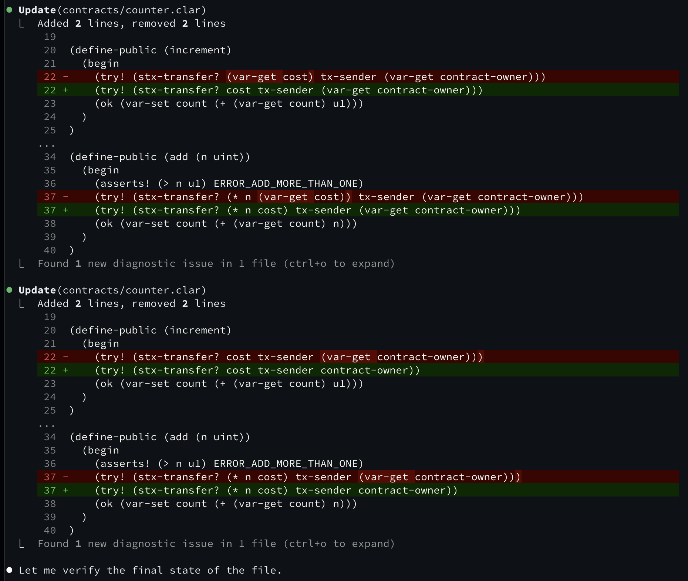

Give Claude the ability to use the Clarity LSP.

# Installation

WIP - [need to publish on a marketplace](https://code.claude.com/docs/en/plugins#create-plugins)

# Dev Usage (no installation)

Clone this repository, then start Claude with from a Clarinet project: 

Example:

```sh
git clone https://github.com/stx-labs/clarity-claude-plugin.git
git clone https://github.com/stx-labs/clarity-starter # if you need a basic Clarity project
cd clarity-starter

# the important part:
claude --plugin-dir ../clarity-claude-plugin
# from there, Claude will get the diagnostics as it interacts with the LSP
```


